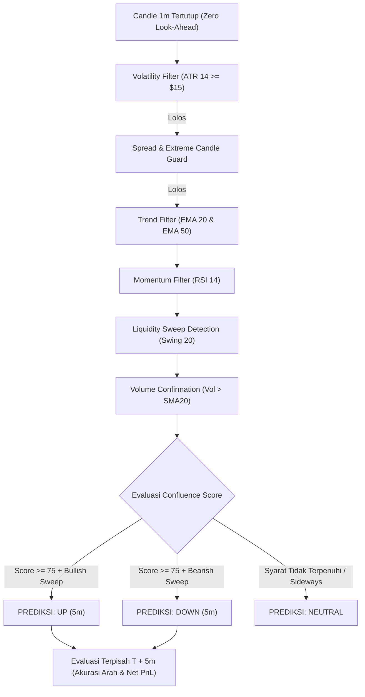

# Binance BTCUSDT 5-Minute Quantitative Prediction Bot

Bot Python profesional untuk menganalisis pergerakan **BTCUSDT** (Binance Futures USDT-M) dan memprediksi arah harga (**UP**, **DOWN**, atau **NEUTRAL**) dalam horizon **5 menit** ke depan menggunakan kombinasi indikator kuantitatif dan analisis likuiditas institusional.

Dirancang khusus agar dapat berjalan ringan, cepat, dan stabil di **Termux Android** maupun server **Linux** tanpa dependensi berat C-compiler.

---

## 1. Arsitektur & Logika Strategi



### Komponen Strategi:
1. **Trend Filter**:
   - `EMA 20 > EMA 50`: Tren Bullish.
   - `EMA 20 < EMA 50`: Tren Bearish.
   - Jika $|EMA20 - EMA50| < \$8.0$: Ditandai sebagai **Sideways**, sinyal ditahan.
2. **Momentum Filter**:
   - **UP**: $50 < \text{RSI} < 75$.
   - **DOWN**: $25 < \text{RSI} < 50$.
   - Menghindari entry saat momentum ekstrim ($>75$ overbought atau $<25$ oversold).
3. **Liquidity Sweep Detection (SMC)**:
   - Dihitung dari 20 candle sebelumnya (tidak termasuk candle sinyal).
   - **Bullish Sweep**: Low candle terbaru menembus swing low sebelumnya, lalu ditutup kembali di atas swing low dengan candle konfirmasi hijau.
   - **Bearish Sweep**: High candle terbaru menembus swing high sebelumnya, lalu ditutup kembali di bawah swing high dengan candle konfirmasi merah.
4. **Volume Confirmation**:
   - Volume candle konfirmasi wajib lebih besar dari rata-rata volume 20 candle sebelumnya (`Volume SMA 20`).
5. **Volatility Filter (ATR 14)**:
   - Menahan sinyal jika ATR $< \$15.00$ karena pergerakan harga terlalu kecil untuk menutup biaya transaksi.
6. **Filter Lilin Ekstrem & Spread**:
   - Menahan sinyal jika body candle melompat $> 2.5\times \text{ATR}$ atau spread bid-ask $> \$5.00$.
7. **Cooldown**:
   - Setelah sinyal dihasilkan, sistem mengunci entry baru selama 5 menit hingga posisi aktif selesai dievaluasi.

---

## 2. Pemisahan Akurasi Arah vs Profitabilitas Riil

> [!IMPORTANT]
> **Prediksi arah yang benar tidak otomatis berarti trade menguntungkan!**
> Pada Binance Futures, terdapat biaya Taker (0.05% open + 0.05% close = 0.10%) serta estimasi slippage (0.04%). Total gesekan pasar per putaran adalah $\approx 0.14\%$. Jika BTC hanya naik tipis $+0.05\%$ dalam 5 menit, prediksi arah adalah **BENAR**, namun hasil ekonomi trade adalah **RUGI BIAYA (LOSS)**.

Bot ini memisahkan secara ketat kedua metrik tersebut pada evaluasi $T+5\text{m}$.

---

## 3. Mode Operasi & Keamanan

Bot Futures saat ini hanya mendukung analisis dan paper tracking. Kode ini belum memiliki order executor atau pelacakan posisi berbasis exchange:

* **MODE 1: `SIGNAL_ONLY` (Default)**
  - Murni menganalisis pasar, menampilkan prediksi di dashboard terminal, dan mengukur akurasi tanpa mengirim order ke Binance.
* **`TESTNET` dan `LIVE` dinonaktifkan** oleh aplikasi. Memilih salah satunya akan menghentikan startup dengan pesan error; `ENABLE_LIVE_TRADING=true` tidak mengaktifkan order.
* Modul `risk_manager.py` hanya menyediakan kalkulasi awal. Batas posisi, kill switch, saldo akun, aturan lot, stop loss, dan take profit belum terhubung ke executor exchange.

---

## 4. Cara Instalasi & Menjalankan di Termux Android

### Langkah 1: Masuk ke Direktori Proyek
```bash
cd ~/binance-prediction-bot
```

### Langkah 2: Buat File `.env`
```bash
cp .env.example .env
```

### Langkah 3: Jalankan Backtest Kuantitatif
Sebelum menjalankan bot secara real-time, jalankan backtest historis dengan pemisahan waktu In-Sample (60%) dan Out-of-Sample (40% unseen data):
```bash
python3 backtest.py --candles 1500
```

### Langkah 4: Jalankan Dashboard Prediksi Real-Time
```bash
python3 main.py
```

### Langkah 5: Menjalankan Unit Test
Untuk memastikan seluruh fungsi matematika dan detektor liquidity sweep 100% akurat:
```bash
python3 -m unittest discover -s tests -p "test_*.py"
```

---

## 5. Struktur Berkas

```
binance-prediction-bot/
├── main.py              # Aplikasi dashboard real-time terminal
├── config.py            # Konfigurasi & parameter kuantitatif
├── binance_client.py    # Client REST API Binance Futures USDT-M
├── indicators.py        # Kalkulator EMA, RSI, ATR, Volume (Pure Python)
├── liquidity_sweep.py   # Detektor Liquidity Sweep tanpa look-ahead bias
├── strategy.py          # Logika evaluasi sinyal multi-indikator
├── prediction.py        # Mesin pelacak & penilai target 5 menit
├── backtest.py          # Modul backtesting historis time-split
├── risk_manager.py      # Manajemen risiko, sizing, & kill switch
├── requirements.txt     # Dependensi library
├── .env.example         # Template konfigurasi environment
├── README.md            # Dokumentasi lengkap
└── tests/
    ├── test_indicators.py # Pengujian unit kalkulator indikator
    ├── test_strategy.py   # Pengujian unit deteksi sweep & filter
    └── test_prediction.py # Pengujian unit evaluasi target 5 menit
```
